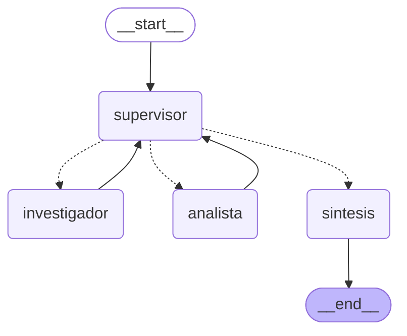

# Pre-entrega 6 — Orquestador multi-agente de análisis e investigación

Un **Supervisor** que recibe la consulta del usuario y decide, turno a turno, a qué especialista
delegar, con qué instrucción, y cuándo la tarea está completa. Dos especialistas con
herramientas propias —un **Investigador** que busca en las políticas internas de TechCorp y un
**Analista** que hace las cuentas— y una fase de **síntesis** que redacta la respuesta final.

| Componente | Elección |
|---|---|
| Topología | Jerárquica: Supervisor + 2 especialistas + síntesis |
| Grafo | `StateGraph(AgentState)`, `AgentState` hereda de `MessagesState` |
| Ruteo | `with_structured_output(DecisionSupervisor)` + `Literal` en `enrutar` |
| Especialistas | `create_agent` de LangChain, cada uno con una sola herramienta |
| Investigador | Búsqueda híbrida BM25 + Pinecone (el sistema de la pre-entrega 4) |
| Analista | Calculadora segura sobre `ast`, sin `eval` |
| Validación | Determinística por especialista (`Contribucion`, Pydantic) + rúbrica en el supervisor |
| Frenos | `MAX_PASOS = 6` + `recursion_limit = 25` |
| LLM | `gemini-flash-lite-latest`, `temperature=0`, con rate limiter |
| Corpus | 4 políticas internas de TechCorp (las de la pre-entrega 3) → 23 fragmentos |

## Instalación

```bash
python -m venv .venv
.venv\Scripts\activate          # Windows
# source .venv/bin/activate     # Linux / macOS
pip install -r requirements.txt

copy .env.example .env          # Windows  (cp en Linux / macOS)
```

Requiere **Python 3.12** — `langchain-pinecone` todavía no soporta 3.13+.

Completar en `.env`:

- `GOOGLE_API_KEY` — gratis en [Google AI Studio](https://aistudio.google.com/apikey). La usan
  el LLM y los embeddings.
- `PINECONE_API_KEY` — gratis en [app.pinecone.io](https://app.pinecone.io)

El `.env` está en `.gitignore` y nunca se sube al repositorio.

## Preparar el índice

Dos comandos, una sola vez. Los dos son idempotentes.

```bash
python scripts/setup_indice.py   # crea el índice Serverless 'techcorp-politicas' si no existe
python scripts/ingestar.py       # limpia, fragmenta, embebe y sube las 4 políticas (~1 min)
```

## Uso

```bash
python main.py                                    # la pregunta de demo
# "En un equipo de TechCorp hay 3 personas con 2 años de antigüedad, 2 con 7 años y 1 con 12 años. ¿Cuántos días de vacaciones suman en total este año según la política vigente?"
python main.py "¿Cuántos días de licencia por mudanza da TechCorp?"  # pregunta de prueba que no requiere llamar al analista ni calcular
```

La respuesta esperada para la pregunta demo (`python main.py`) es **112 días** y el recorrido es el de la
[traza de ejecución](#traza-de-ejecución) de más abajo.

Cada paso se imprime a medida que ocurre —qué decidió el supervisor, por qué, y si el aporte de
cada especialista pasó la validación— y la traza completa queda en `traza_delegacion.json`.

La demo del flujo de delegación está en **[`demo_delegacion.ipynb`](demo_delegacion.ipynb)**,
ejecutado con salidas reales: delegación completa, una pregunta de un solo dominio, y el camino
de fallo.

## Topología elegida: jerárquica



Generado con `app.get_graph().draw_mermaid()`; la versión en imagen, con `draw_mermaid_png()`,
está en [`docs/grafo.png`](docs/grafo.png). Las flechas punteadas son aristas condicionales: el
supervisor es el único nodo que tiene. Los especialistas siempre vuelven a él, nunca hablan entre
sí, y solo la síntesis llega a `END`.

**Por qué jerárquica y no cooperativa.** El problema tiene un orden natural —primero el dato,
después la cuenta, después la respuesta— y la clase recomienda jerarquía justamente para
workflows semi-deterministas como este. Lo que da:

- **Un único punto de control.** Todas las decisiones de ruteo pasan por un solo nodo y quedan
  registradas con su razón en `decisiones`. En una topología cooperativa, entender por qué el
  sistema hizo lo que hizo exige reconstruir la reacción en cadena entre pares.
- **Un validador antes de cerrar.** El supervisor revisa cada aporte antes de dar la tarea por
  terminada. Sin jefe, nadie tiene la autoridad para decir "esto no alcanza, rehacelo".
- **Especialistas aislados.** El investigador no sabe que existe un analista. Se puede cambiar
  uno sin tocar el otro, y un fallo de uno no contamina al otro.

El precio es el que marca la clase: el supervisor es un cuello de botella y un punto único de
falla. Acá se mitiga con dos cosas: si el LLM del supervisor falla o no devuelve una decisión, el
grafo cierra por la síntesis en vez de colgarse; y el tope de pasos corta sin consultar al LLM.

La delegación es **dinámica**, no un pipeline fijo: una pregunta que no necesita cálculo
("¿cuántos días presenciales exige el esquema híbrido?") va al investigador y cierra, sin que el
analista intervenga. El escenario 2 del notebook lo muestra.

## Estado compartido (`state.py`)

`AgentState` hereda `messages` de `MessagesState` y suma los campos de coordinación. Cada nodo es
dueño de una parcela y solo escribe ahí (**aislamiento de escritura**):

| Campo | Lo escribe | Reducer | Para qué |
|---|---|---|---|
| `messages` | especialistas, síntesis | `add_messages` | la conversación visible |
| `contribuciones` | especialistas | `operator.add` | quién aportó qué, y si pasó la validación |
| `pasos` | especialistas | reemplaza | cuenta para `MAX_PASOS` |
| `next_agent` | supervisor | reemplaza | a quién va el próximo turno |
| `instruccion` | supervisor | reemplaza | la tarea puntual para ese especialista |
| `decisiones` | supervisor | `operator.add` | el log: quién decidió qué y por qué |
| `task_completed` | supervisor | reemplaza | si cerró |

Las dos listas usan `operator.add`: cada nodo devuelve solo lo nuevo y LangGraph lo concatena, así
que ningún aporte pisa a otro. Un test verifica que cada nodo devuelve **solo** sus claves.

Lo que un especialista aporta pasa por el contrato **`Contribucion`** (Pydantic) antes de entrar
al estado: un aporte vacío, firmado por un agente que no existe o sin la tarea que respondía se
rechaza ahí mismo, no tres pasos después cuando el supervisor lo lea.

**Contexto acotado, en las dos direcciones.** El especialista no recibe el historial: recibe
**solo** la `instruccion` que el supervisor escribió para él, en una conversación nueva. Por eso
el prompt del supervisor le exige instrucciones autocontenidas, y por eso la instrucción al
analista trae los números que encontró el investigador.

El aislamiento también corta de vuelta, y eso se aprendió en una corrida real. A la pregunta
*"¿Cuántos días de licencia por mudanza da TechCorp?"*, el investigador contestó *"Corresponde 1
día por año calendario"*: correcto, pero sin decir de qué, porque en su conversación la pregunta
era obvia. El supervisor recibía esa respuesta suelta, con `politica_vacaciones.txt` como fuente,
creyó que era un dato de vacaciones y pidió la búsqueda **cinco veces**. Por eso cada
`Contribucion` guarda su `tarea`, y el supervisor ve cada aporte junto a la pregunta que respondía.
Con ese cambio, la misma consulta cierra en el primer turno.

## Validación y manejo de conflictos

**1. Validación determinística en cada especialista.** Con código, no con el juicio de un LLM:
un texto que "suena" a dato puede ser inventado. Cada nodo mira qué herramientas ejecutó su agente
y qué devolvieron:

| Especialista | Válido si… | Motivos de rechazo |
|---|---|---|
| Investigador | ejecutó la búsqueda y devolvió fragmentos | respondió de memoria · la búsqueda falló · no encontró nada |
| Analista | ejecutó la calculadora y hay un `Resultado:` | hizo la cuenta de cabeza · la calculadora devolvió error |

El Analista es el caso más claro: un LLM puede llegar al número correcto sin la calculadora, y aun
así el aporte se rechaza. No se puede distinguir un acierto de una alucinación confiada; lo que sí
se puede verificar es que el número salió de la herramienta.

**2. Rúbrica en el prompt del supervisor.** Las contribuciones le llegan marcadas `[VÁLIDA]` o
`[INVÁLIDA: motivo]`. Una inválida no cuenta como hecha, y `FINISH` solo procede cuando los aportes
**válidos** alcanzan para responder la pregunta original.

**3. Bucle de reparación con el error concreto.** Ante un aporte inválido, el supervisor vuelve a
delegar al mismo especialista con una instrucción que corrige ese problema puntual — no con un
"intentá de nuevo", que probablemente repita el mismo sesgo. El motivo del validador es lo que le
permite hacerlo.

**4. Síntesis solo con lo verificado.** Los aportes inválidos se le pasan aparte, rotulados "no
los uses como dato", y el prompt le exige decir qué no se pudo verificar en vez de completar con
suposiciones.

**5. Frenos contra el "supervisor infinito".** Tres, del más específico al más general:

- **Repetición de una tarea ya resuelta.** La decisión del supervisor se revisa con código antes de
  ejecutarla, igual que los aportes de los especialistas: si le pide a un especialista una tarea que
  ese mismo especialista ya resolvió con un aporte **válido**, se cierra por la síntesis — repetirla
  no puede traer información nueva. Compara el texto normalizado, así que detecta repeticiones
  literales (en el bucle de la mudanza, cuatro de las cinco instrucciones eran idénticas letra por
  letra). Reintentar una tarea cuyo aporte fue **inválido** sigue permitido: ese es el bucle de
  reparación del punto 3, y el freno no lo toca.
- **`MAX_PASOS = 6`** corta de forma determinística, sin consultar al LLM, aunque las instrucciones
  vengan reformuladas.
- **`recursion_limit = 25`** es la última red, por si algo en el ruteo fallara.

**6. Fallos sin romper el grafo.** Si un especialista lanza una excepción, su nodo la convierte en
una contribución inválida con el error como motivo. Si el supervisor falla o no devuelve una
decisión estructurada, cierra por la síntesis. Si la síntesis falla, devuelve los aportes
verificados en crudo. Ninguna excepción deja el estado en un limbo.

**Conflictos entre agentes.** Por construcción, los especialistas no pueden contradecirse
escribiendo sobre el mismo dato: cada uno tiene su parcela y el único que integra es el supervisor.
El conflicto real posible es de contenido —que el analista calcule sobre números distintos de los
que trajo el investigador— y se resuelve por **trazabilidad**: el investigador cita la fuente de
cada fragmento (`[Fuente: politica_vacaciones.txt]`), y es el supervisor quien copia esos números
en la instrucción del analista. El analista nunca elige de dónde salen los datos.

## Traza de ejecución

Ejemplo de salida de `python main.py` (completa en [`traza_delegacion.json`](traza_delegacion.json)):

```
[supervisor] -> investigador
   razón: Faltan los datos de las políticas internas de TechCorp sobre la cantidad de días
          de vacaciones según los años de antigüedad.
   instrucción: Busca en las políticas internas de TechCorp cuántos días de vacaciones
          corresponden para empleados con 2, 7 y 12 años de antigüedad respectivamente.

[investigador] VÁLIDA  (herramientas: buscar_en_politicas_internas)
   2 años: 14 días corridos (menos de 5 años) · 7 años: 21 días (5 a 10 años) ·
   12 años: 28 días (más de 10 años). Fuente: politica_vacaciones.txt

[supervisor] -> analista
   razón: El investigador ya obtuvo los días por antigüedad. Ahora falta calcular el total
          para el equipo.
   instrucción: Calculá el total con los datos de la política: 3 personas con 14 días cada
          una, 2 con 21 días y 1 con 28 días. Multiplicá y sumá los subtotales.

[analista] VÁLIDA  (herramientas: calculadora)
   Resultado: 112

[supervisor] -> FINISH
   razón: El investigador obtuvo las políticas y el analista realizó el cálculo total de
          112 días, respondiendo completamente a la pregunta original.

[síntesis]
   Según la política de vacaciones de TechCorp, el total es 112 días:
   3 × 14 + 2 × 21 + 1 × 28 = 42 + 42 + 28 = 112.

Flujo: supervisor -> investigador -> supervisor -> analista -> supervisor -> sintesis
```

Unos 45 segundos y 8 llamadas al LLM: 3 decisiones del supervisor, 2 por cada especialista (pedir
la herramienta y responder) y 1 de síntesis.

## Tests

```bash
pytest
```

64 tests, menos de un segundo, **sin una sola llamada a una API**. Los cuatro roles y el sistema de
recuperación se reemplazan por dobles guionados; lo que se ejercita es el grafo real.

| Archivo | Qué cubre |
|---|---|
| `test_herramientas.py` | Calculadora (aritmética, rechazo de código, constantes no numéricas, exponentes gigantes) y búsqueda (cita de fuentes, sin resultados, falla de Pinecone) |
| `test_validacion.py` | El contrato `Contribucion` (incluida la `tarea` obligatoria) y los dos validadores determinísticos |
| `test_supervisor.py` | Decisiones y su registro, `MAX_PASOS` sin consultar al LLM, fallbacks, rúbrica con la tarea de cada aporte, freno de repeticiones (y que no bloquee el reintento de un aporte inválido), síntesis |
| `test_grafo.py` | La topología: quién se conecta con quién y qué aristas son condicionales |
| `test_flujo.py` | Delegación completa, contexto acotado, un solo dominio, refinamiento, especialista que falla, supervisor infinito, regresión del bucle de la mudanza, aislamiento de escritura |

Cómo se sustituye cada rol: los nodos resuelven su agente o su LLM como global del módulo en cada
llamada, así que una fixture lo pisa con `monkeypatch` sin reconstruir el grafo.

Como red de seguridad, una fixture `autouse` deja en el lugar de cada cliente real un objeto que
falla si alguien lo usa. Esa falla es una `BaseException` y no una `Exception`, a propósito: los
nodos capturan `Exception` para que un fallo no rompa el grafo, y esa misma resiliencia se tragaba
una falla común — el supervisor la registraba como "no pudo decidir", el grafo cerraba prolijo y
el test pasaba en silencio. Con `BaseException`, un test que se olvide de instalar un doble falla
donde tiene que fallar.

## Estructura

```
pre-entrega-6/
├── state.py                 # AgentState + contrato Contribucion
├── agents/
│   ├── llm.py               # el LLM compartido, con rate limiter
│   ├── comun.py             # invocar un especialista y leer lo que hizo
│   ├── research_agent.py    # Investigador: búsqueda + agente + validación + nodo
│   ├── analyst_agent.py     # Analista: calculadora + agente + validación + nodo
│   └── supervisor.py        # Supervisor (router + rúbrica) y síntesis
├── graph.py                 # el StateGraph
├── main.py                  # CLI: corre una consulta e imprime el flujo
├── rag/                     # el sistema de recuperación de la pre-entrega 4
├── scripts/                 # setup_indice.py, ingestar.py
├── data/                    # las 4 políticas de TechCorp
├── docs/grafo.png           # draw_mermaid_png()
├── demo_delegacion.ipynb    # demo del flujo de delegación
├── traza_delegacion.json    # traza real de main.py
└── tests/                   # 64 tests sin API
```
